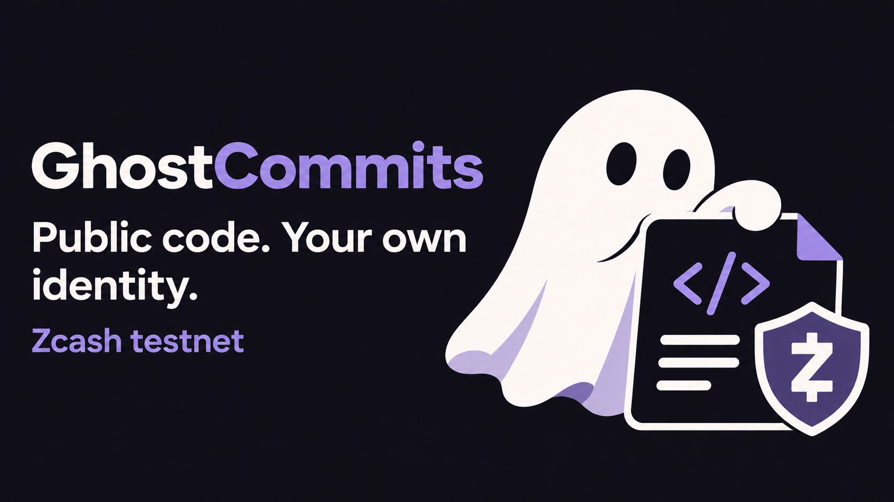
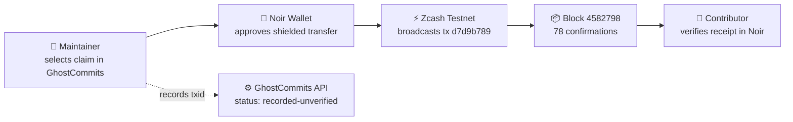
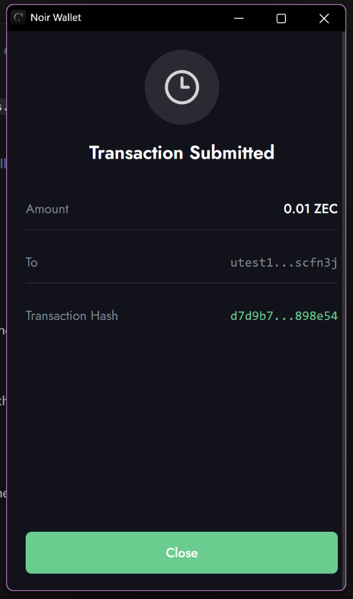
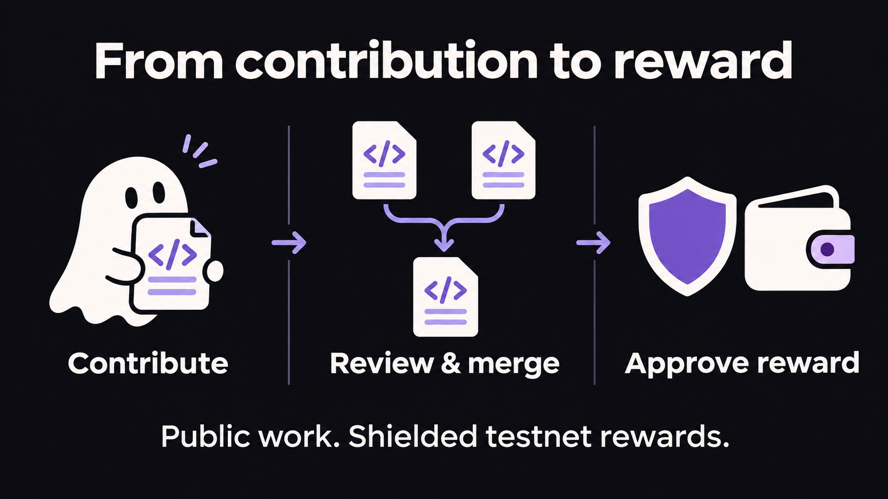
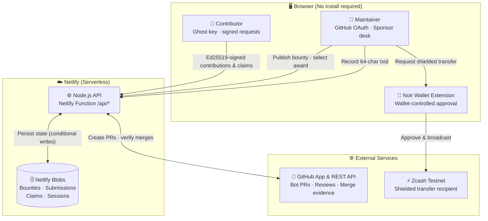
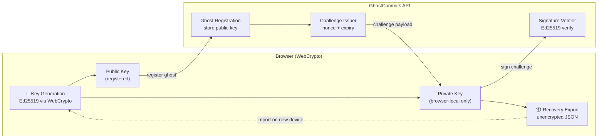
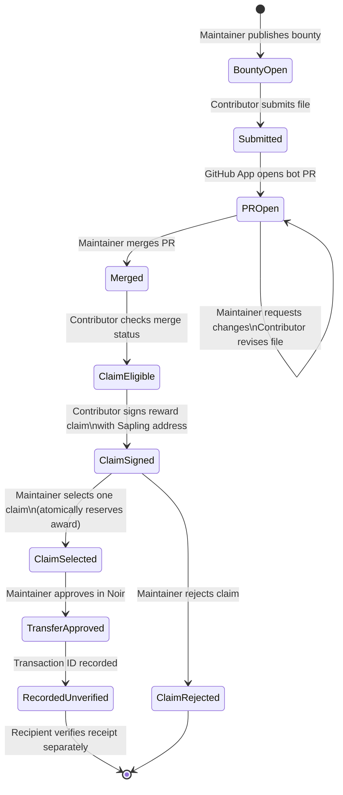
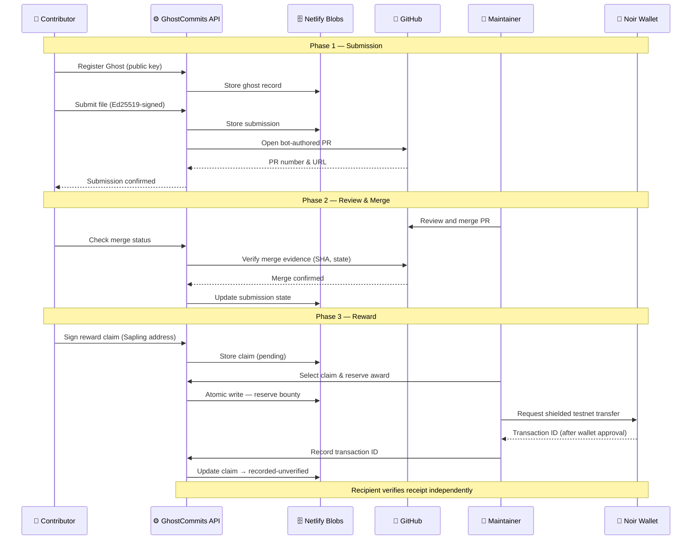
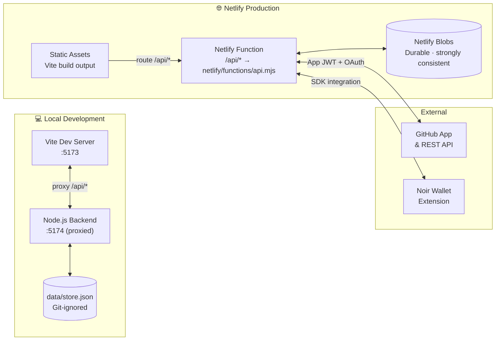

<p align="center">
  
</p>

# GhostCommits

**Contribute to open source without a personal GitHub login. Request a shielded Zcash testnet reward for accepted work.**

🌐 **Live App:** <https://ghostcommits.netlify.app>

GhostCommits brings a local signing identity, bot-authored pull requests, maintainer review, and wallet-approved rewards into one browser workspace. Your code stays public. You choose a separate identity for your contributions. Maintainers keep their existing GitHub review process.

**Testnet MVP · Public repositories · One file per submission · One award per bounty**

[Live App](https://ghostcommits.netlify.app) · [How it works](#how-it-works) · [Live transaction](#live-testnet-transaction) · [Run locally](#run-locally) · [Architecture](#architecture) · [Verification](#implementation-and-verification) · [Zcash feedback](ZCASH-FEEDBACK.md)

---

## Live testnet transaction

This is a real, confirmed shielded Zcash testnet transfer triggered through the GhostCommits reward flow — a maintainer approved the payout in Noir Wallet and the transaction was broadcast to the Zcash testnet.

| Field           | Value                                                                                                                                                                                                      |
| --------------- | ---------------------------------------------------------------------------------------------------------------------------------------------------------------------------------------------------------- |
| **Transaction** | [`d7d9b789...8e54`](https://testnet.zecblock.com/tx/d7d9b789f4db2fbd33db1defd27e8efcab4b62aa7506464230a0969485898e54)                                                                                     |
| **Explorer**    | [testnet.zecblock.com](https://testnet.zecblock.com/tx/d7d9b789f4db2fbd33db1defd27e8efcab4b62aa7506464230a0969485898e54)                                                                                   |
| **Block height** | 4 582 798                                                                                                                                                                                                 |
| **Block hash**  | `000018388d3edd77c94aae2efd82881cc17d276aee70526edc24c4e7712949ae`                                                                                                                                        |
| **Confirmations** | 78 (at time of export)                                                                                                                                                                                   |
| **Fee**         | 0.00002 ZEC (testnet)                                                                                                                                                                                      |
| **Tx size**     | 9 166 bytes                                                                                                                                                                                                |
| **Version**     | 6 (Zcash v6 transaction format)                                                                                                                                                                            |
| **Shield type** | Fully shielded — inputs, outputs, and amounts are not visible on-chain (`saplingSpendCount: 0`, `saplingOutputCount: 0`, `orchardActions: 0` fields indicate no transparent components were exposed)       |

> [!NOTE]
> Zcash shielded transactions deliberately expose no input addresses, output addresses, or amounts in public block data. The explorer shows the transaction exists and is confirmed, but cannot reveal sender, recipient, or value — that is the privacy guarantee Zcash provides. GhostCommits records the transaction ID as **`recorded-unverified`**; the recipient confirms receipt independently through their own Noir Wallet.

### What this proves



The full end-to-end flow — bounty published, file submitted, PR merged on GitHub, claim signed with a Sapling address, maintainer approval in Noir, shielded broadcast, and recipient receipt — has been executed on the Zcash testnet. This transaction is the on-chain evidence of the reward step.

<p align="center">
  
</p>

**Noir Wallet confirms:** `0.01 ZEC` sent to `utest1...scfn3j` · transaction hash `d7d9b7...898e54` · status: submitted.

---

## Why this should exist

A useful contribution can be small: fix a broken example, clarify an installation step, or repair a single function. A developer should be able to offer that work under an identity they choose, and a maintainer should be able to review it without changing how their project runs.

Someone who wants to keep that work separate from their usual GitHub identity has to manage another account and arrange any reward separately. GhostCommits brings those steps together: create a Ghost, submit a file, respond to review, and request a reward from the same workspace.

The first use case is deliberately narrow: **small, clearly scoped open-source bounties**. It could help an occasional contributor make a quick fix, a developer keep an experimental contribution separate from their main profile, or a maintainer offer a reward for a neglected documentation task. These are intended users, not claims of existing adoption. A pilot still needs to establish whether people find this useful enough to return.

## Why Zcash belongs here

Public code review and payment privacy serve different purposes. Review needs an inspectable diff and a clear acceptance decision. A reward does not need to add a transparent payment trail to that public work.

GhostCommits integrates Noir Wallet to request a transfer from **shielded funds to a Sapling testnet recipient**. The contributor signs the reward request with the Ghost identity associated with the submission; the maintainer chooses the award and approves the transfer in their own wallet. The application does not hold wallet spending keys.

This puts Zcash in an everyday developer workflow. It is also a limited privacy claim: the operator and maintainer can see the reward address and associated claim. Shielded transfers do not make the application anonymous.

---

## How it works



_These AI-generated illustrations explain the product. They are not screenshots or evidence of completed transactions._

### For contributors

1. **Choose a bounty.** Read the repository, acceptance criteria, and testnet reward before starting.
2. **Create your Ghost.** Generate a local signing identity and export its recovery key. No personal GitHub login is required.
3. **Submit one complete file.** The GitHub App opens a bot-authored pull request associated with your Ghost.
4. **Respond to review.** Read feedback on the public PR, then revise the same file from **My contributions**. Revisions update the same PR.
5. **Request the reward after merge.** Check merge status, provide a valid Sapling testnet address, and sign the claim. Noir can fill in your receiving address.

> A merged PR makes a claim eligible for review; it does not guarantee selection or payment.

### For maintainers

1. Open **Sponsor desk**, sign in with GitHub, and install the GitHub App on a public repository you manage.
2. Refresh repositories and publish a small task with clear acceptance criteria and a testnet reward. Published terms are fixed.
3. Review and merge the contribution on GitHub using your normal process.
4. Review eligible claims, choose one award, connect a funded Noir testnet wallet, and approve the shielded transfer in the extension.
5. Check wallet history and recipient receipt. GhostCommits records a transaction ID as **`recorded-unverified`**, not confirmed payment.

> Multiple contributors can request review. Selecting a claim atomically reserves the bounty's single award.

### Small tasks, a browser, and a recoverable identity

You do not need a local Git checkout or a personal GitHub login to submit a file through the contributor interface. Bounties, submissions, and claim progress live in one workspace. The layout adapts to smaller screens for checking work on the go.

The Ghost key lives in that browser. Export it before clearing browser data, and import the recovery file when moving to another device. There is no automatic identity sync. Wallet approval requires a compatible Noir testnet extension; an end-to-end mobile wallet flow has not been established.

---

## A walkthrough for reviewers

Use a public test repository with an existing default branch and a task small enough to finish in one file, such as improving a README usage example. The operator must first complete the [deployment setup](docs/NETLIFY_DEPLOYMENT.md).

| Step       | Action                                                           | What to inspect                                                   |
| ---------- | ---------------------------------------------------------------- | ----------------------------------------------------------------- |
| Publish    | Maintainer creates a bounty.                                     | Repository, fixed terms, and testnet reward.                      |
| Contribute | A separate browser profile creates a Ghost and submits the file. | Real bot-authored PR, without contributor GitHub sign-in.         |
| Revise     | Maintainer requests a change; the Ghost submits a revision.      | The same PR receives the update.                                  |
| Merge      | Maintainer merges; contributor checks merge status.              | GitHub merge evidence in contribution history.                    |
| Claim      | Contributor signs a request with a Sapling testnet address.      | Claim associated with the submitting Ghost.                       |
| Approve    | Maintainer selects the claim and approves in Noir.               | Shielded spendability check, wallet approval, one reserved award. |
| Verify     | Check sender history and recipient receipt; reload the app.      | Persistent records; transaction remains unverified in the UI.     |

> [!WARNING]
> **If wallet approval is declined or interrupted, the award stays reserved.** Check the sender's wallet history before taking another action. If a transfer exists, use **Record transaction** with its 64-character transaction ID. There is no automatic resend or reservation reset; a definitive no-transfer outcome requires operator reconciliation.

---

## Architecture

### System overview



### Identity and signing flow



### Contribution lifecycle



### Request & data flow (sequence)



### Deployment architecture



### Tech stack

| Layer     | Implementation                                                                           |
| --------- | ---------------------------------------------------------------------------------------- |
| Interface | Vite, vanilla JavaScript, responsive CSS, self-hosted Inter                              |
| Identity  | Browser-generated Ed25519 keys, signed challenges, recovery import/export                |
| GitHub    | App installation access, maintainer OAuth, bot-authored PRs and revisions                |
| API       | Node.js locally; Netlify Function for `/api/*` in deployment                             |
| Storage   | Netlify Blobs; Git-ignored JSON file locally outside Netlify                             |
| Rewards   | `@noir-wallet/sdk`, shielded spendability checks, wallet approval, transaction recording |

> [!NOTE]
> The deployed MVP stores aggregate state in one strongly consistent blob. Conditional writes reject stale updates with HTTP 409, including competing award selections. Operations are not automatically replayed. Production data persists across deploys; preview stores are isolated. This suits a small, low-traffic pilot.

---

## Run locally

Requires **Node.js 22.12 or newer** and npm.

```sh
npm ci
```

Copy `.env.example` to `.env`:

```powershell
# PowerShell
Copy-Item .env.example .env
```

```sh
# macOS / Linux
cp .env.example .env
```

Configure the GitHub App and session encryption key using the [setup guide](docs/NETLIFY_DEPLOYMENT.md). Locally, match the GitHub callback to `http://localhost:5173/api/github/callback` and keep `APP_ORIGIN=http://localhost:5173`.

```sh
npm run dev
```

Open **<http://localhost:5173>**. Vite proxies API requests to the backend. Outside Netlify, state is stored in Git-ignored `data/store.json`; only one backend process should own that file. Starting the interface alone does not configure GitHub, publish a bounty, or fund a wallet.

For rewards, install a compatible official Noir testnet extension, synchronize the wallet, and fund the maintainer with spendable **shielded testnet ZEC plus fees**. The integration requires `getMaxTransfer` and shielded `fundingSource` support. Contributors can also enter a valid Sapling testnet receiving address manually.

---

## Deploy on Netlify

Live application: <https://ghostcommits.netlify.app>

The repository includes `netlify.toml`, the API function, and durable Blobs storage. The operator registers one public GitHub App; maintainers then sign in and install it on their own repositories. Maintainers do not paste GitHub tokens or use a shared operator password.

| Runtime variable         | Purpose                                                             |
| ------------------------ | ------------------------------------------------------------------- |
| `APP_ORIGIN`             | Exact deployed HTTPS origin, without a trailing slash               |
| `GITHUB_APP_ID`          | GitHub App ID                                                       |
| `GITHUB_CLIENT_ID`       | GitHub App client ID                                                |
| `GITHUB_CLIENT_SECRET`   | GitHub App client secret                                            |
| `GITHUB_APP_PRIVATE_KEY` | Full PEM private key                                                |
| `SESSION_ENCRYPTION_KEY` | Stable encryption key: 32 random bytes encoded as 64 hex characters |

> [!IMPORTANT]
> Netlify supplies Blobs access automatically; no database connection is required. Keep secrets out of Git and `VITE_*` variables, and redeploy after configuration changes. A static-only deployment is insufficient.

Follow [Netlify deployment and live verification](docs/NETLIFY_DEPLOYMENT.md) for permissions, OAuth settings, database requirements, health checks, and troubleshooting.

---

## Implementation and verification

| Area                      | Current scope                                                                                                                |
| ------------------------- | ---------------------------------------------------------------------------------------------------------------------------- |
| Ghost identity            | Creation, recovery export/import, signed authentication and reward requests                                                  |
| Contributions             | Public-repository bounties, one-file bot PRs, revisions, merge checks                                                       |
| Maintainers               | GitHub sign-in, repository permission checks, fixed bounty terms, claim rejection and selection                              |
| Rewards                   | Noir connection, address autofill, balance display, shielded spendability checks, approval request and transaction recording |
| Persistence               | Durable deployed state and atomic reservation of one award per bounty                                                        |
| Outstanding live evidence | ✅ Live shielded testnet transfer confirmed — [tx d7d9b789](https://testnet.zecblock.com/tx/d7d9b789f4db2fbd33db1defd27e8efcab4b62aa7506464230a0969485898e54), block 4582798, 78 confirmations |

> [!NOTE]
> Automated coverage uses mocked external integrations. It does not establish that a live wallet transfer or GitHub installation has succeeded. See [implementation status](docs/IMPLEMENTATION_STATUS.md).

```sh
npm test
npm run build
npx playwright install chromium
npm run test:browser
```

API tests exercise local JSON storage and an isolated local Blobs test service, including authentication, tenant isolation, revisions, competing claims, and persistence. Browser tests exercise the built frontend with mocked API responses.

---

## Privacy and current limits

> [!CAUTION]
> **This is a testnet MVP, not a production-audited payment service. Testnet ZEC has no monetary value.**

- **Public work:** code, PRs, review, and timing remain visible. Review file contents for identifying information before submitting.
- **Operator visibility:** the service can associate a Ghost with submissions and claims, and can observe network metadata. Maintainers and the operator see reward addresses.
- **Local keys:** Ghost keys and recovery exports are unencrypted. Protect the browser profile and recovery file. A signature proves key control, not original authorship.
- **Limited scope:** public repositories, one file per submission, one award per bounty, and Sapling testnet recipients beginning with `ztestsapling1` only.
- **No payment guarantee:** no mainnet, escrow, guaranteed funding, automatic payment confirmation, or automatic resend. Maintainer approval is required.
- **History:** contribution history depends on service storage. It is not a portable credential or an independently verifiable reputation system.

GitHub user tokens are encrypted at rest, and maintainer sessions use HttpOnly cookies with a maximum eight-hour lifetime. Read the [security boundaries](docs/SECURITY.md) before operating an instance.

---

## Next steps

The next milestone is a documented live contribution and recipient-wallet receipt, followed by a small pilot with contributors and maintainers. That will test whether contributors find this easier than maintaining a separate GitHub account, and whether maintainers want to repeat the workflow.

Further work includes safer local key storage, better interrupted-payment reconciliation, independent payment verification, and broader contribution support. These are future work, not current features.

---

## Repository guide

| Path                                                   | Contents                                                           |
| ------------------------------------------------------ | ------------------------------------------------------------------ |
| `src/`                                                 | Browser workspace, identity, views, and Noir integration           |
| `server/`                                              | API, authentication, GitHub integration, bounty logic, and storage |
| `netlify/`                                             | Serverless entry point and durable Blobs storage                   |
| `tests/`                                               | API, wallet, client, deployment-handler, and browser checks        |
| [Deployment guide](docs/NETLIFY_DEPLOYMENT.md)         | Setup and live verification walkthrough                            |
| [Implementation status](docs/IMPLEMENTATION_STATUS.md) | Current scope and outstanding evidence                             |
| [Security](docs/SECURITY.md)                           | Trust model and security limits                                    |
| [Visual assets](docs/assets/README.md)                 | AI illustrations and exact generation prompts                      |
| [Zcash feedback](ZCASH-FEEDBACK.md)                    | Builder feedback on testnet onboarding                             |

The [original architecture proposal](docs/ARCHITECTURE.md), [PRD](docs/PRD.md), and [earlier MVP audit](docs/MVP_CONTRACT.md) remain as historical design context. Use this README and the current implementation status for today's scope.
