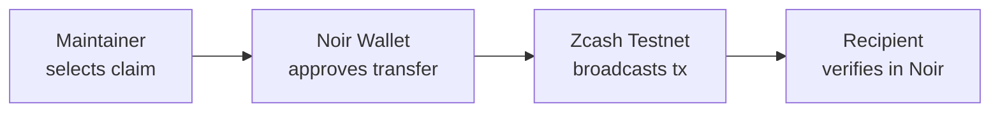
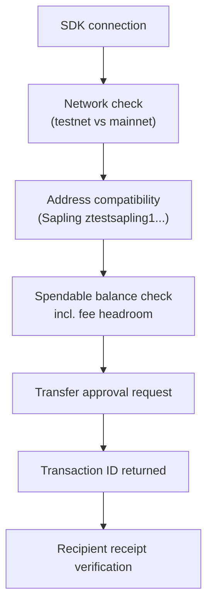
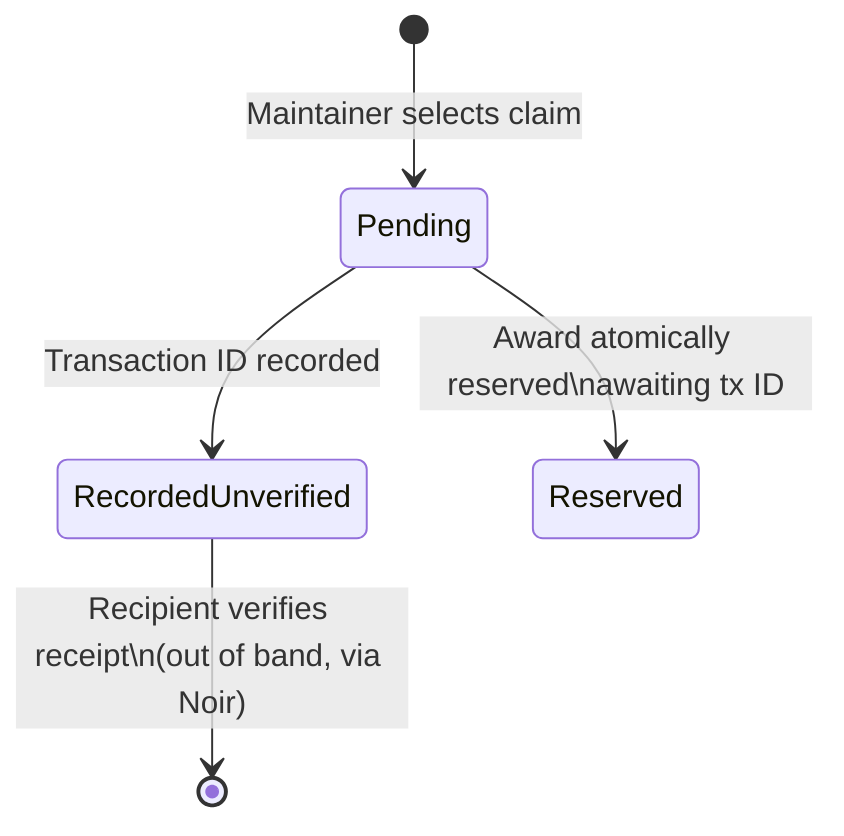

# Feedback to the Zcash ecosystem

**From building GhostCommits** — a browser workspace for pseudonymous open-source contributions with shielded Zcash testnet rewards.

> [!NOTE]
> This is feedback from our specific build experience, not a claim that every wallet or developer encounters the same issues. We shipped a working testnet integration and completed a [real shielded transfer](https://testnet.zecblock.com/tx/d7d9b789f4db2fbd33db1defd27e8efcab4b62aa7506464230a0969485898e54) — these are the friction points we hit along the way.

---

## What we built

GhostCommits lets contributors submit code to open-source projects under a local Ghost identity (browser-generated Ed25519 key, no GitHub login), and lets maintainers reward accepted work with a shielded Zcash testnet transfer via Noir Wallet. The reward flow looks like this:



We completed this end-to-end flow. The confirmed on-chain evidence:

| Field | Value |
|---|---|
| **Transaction ID** | [`d7d9b789f4db2fbd33db1defd27e8efcab4b62aa7506464230a0969485898e54`](https://testnet.zecblock.com/tx/d7d9b789f4db2fbd33db1defd27e8efcab4b62aa7506464230a0969485898e54) |
| **Block** | 4 582 798 |
| **Confirmations** | 78 |
| **Fee** | 0.00002 ZEC (testnet) |
| **Privacy** | Fully shielded — sender, recipient, and amount are not visible in block data |

The integration required `@noir-wallet/sdk`, shielded spendability checks (`getMaxTransfer`, `fundingSource`), wallet-approved transfer requests, and manual transaction ID recording. Getting there took more effort than we expected.

---

## Testnet funds should be easier to find

We did not find a clear, obvious path to a usable testnet faucet. When a project depends on sending a payment, getting test funds is a mandatory setup step — not an optional extra. If that step is unclear, it becomes difficult to tell whether a blocked test comes from our code, wallet setup, or simply a lack of funds.

**What would help:**

- One clearly linked testnet funding page in the developer documentation, with a maintained faucet
- Explicit information on availability, supported address types (transparent vs. Sapling vs. Orchard), and per-request limits
- A fallback strategy documented for when the faucet is unavailable
- An explanation of whether received funds need an additional shielding or synchronization step before an app can spend them as shielded balance

For a hackathon, predictable access to enough testnet funds for repeated small transfers — including intentional retries and failures — makes a real difference. Teams need to exercise edge cases, not just the happy path.

---

## Wallet installation needs a clearer starting point

Getting a Zcash wallet ready for this integration was not as straightforward as we hoped. Our application uses the Noir testnet extension, which meant we needed the right wallet build, the right network selected, a supported receiving address format, and the specific provider methods our SDK calls. These requirements are individually documented in different places, but nowhere pulled together for an application developer.

**What would help:**

A short, maintained guide for this exact journey:

```
Install from official source
  → Create testnet account
    → Back up the wallet
      → Synchronize to testnet chain tip
        → Receive test funds
          → Verify spendable shielded balance
            → Make first shielded transfer
```

Clear browser and platform requirements before installation would remove guesswork. It would also help to distinguish **"wallet connected"** from **"wallet ready to send"** — a connected wallet may still need funds, synchronization time, or specifically shielded (not transparent) spendable balance before a transfer can proceed. Making those states visible would improve onboarding for builders and their users.

---

## Documentation should connect the whole flow

The main documentation challenge was piecing together the path from wallet setup to a working application payment. Individual API method references are useful, but a new builder also needs to know how the pieces fit together in sequence.

**What we needed but had to assemble ourselves:**



A single small, maintained example covering this full chain — with the wallet and SDK versions clearly stated, testnet and mainnet instructions separated — would have saved us significant time.

**Error examples matter too.** A production payment interface needs to handle:

| Scenario | Expected behavior |
|---|---|
| User declines approval in wallet | Surface clear cancellation, do not retry automatically |
| Insufficient shielded funds | Distinguish from insufficient *total* balance — shielding step may be needed |
| Wallet still syncing | Show sync state; block transfer until ready |
| Wrong network selected | Detect mismatch before attempting transfer |
| Connection lost mid-send | Do not retry blindly; check transaction history first |

None of these are edge cases. They are normal parts of building a payment interface.

---

## Payment status needs precise guidance

One important design question for us was: **what can an application safely claim after a wallet request completes?**

A returned or manually entered transaction ID is not, by itself, independent proof that the intended recipient received the intended amount. GhostCommits currently labels stored transaction IDs `recorded-unverified` and directs users to check wallet history and recipient receipt separately. We chose conservative language because we could not find a documented standard for what verification actually means in a shielded context.

**What would help:**

- A documented approach to payment status that explains the available evidence at each stage — broadcast, confirmed, recipient receipt — and the privacy tradeoffs involved at each
- A clear statement of what a transaction ID alone proves and what it does not
- A worked example for interrupted requests: if a connection drops after a wallet *may* have sent funds, retrying blindly can create a duplicate payment. A reconciliation pattern would help developers handle this without inventing their own rules

Our current payment status model:



We would welcome official guidance on how to advance status responsibly.

---

## Make the first successful transfer the onboarding goal

The most useful single improvement would be an official "first transfer" guide that takes a new builder through wallet installation, testnet funding, a small shielded transfer, and receipt checking — in one place, in one sequence, with the expected result at each step and a clear date stamp on the compatibility information.

For GhostCommits, those improvements would directly reduce the barrier to onboarding maintainers. Our contributor flow starts with just a browser and a local identity, but the reward experience still depends on a maintainer getting a funded Noir wallet ready. Making that first transfer easier would let projects like ours spend more time testing whether people actually want the product — rather than debugging setup.

---

## Summary

| Friction area | Specific ask |
|---|---|
| Testnet funds | One maintained faucet page with limits, address types, shielding step |
| Wallet setup | End-to-end install → sync → fund → send guide with version info |
| SDK documentation | Full connection-to-receipt example, with error cases |
| Payment status | Documented verification model and interrupted-send reconciliation |
| Onboarding | Single "first transfer" quickstart for application builders |

We want to make Zcash useful in a familiar activity: contributing to open source. A smoother testnet path would make it much easier to build that experience, explain it honestly, and put it in front of real users.
